<p align="center">
  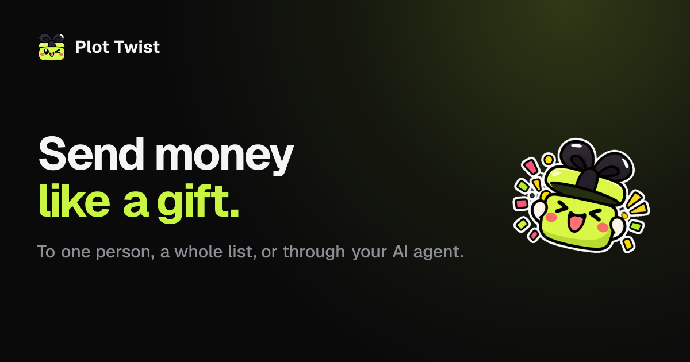
</p>

<p align="center">
  <b>Describe a gift in one sentence. AI designs it, Kite Passport pays for it, and they unwrap it from a single link.</b>
</p>

<p align="center">
  
  
  
  
  
</p>

---

## What it is

Sending money to someone you care about usually feels like paying an invoice. **Plot Twist turns it into a gift.**

You type one sentence — *"Birthday gift for my sister Maya, around $50 — she just moved to Berlin."* **SERV** turns it into a gift: who it's for, the occasion, the amount and a personal note about her new city. You approve one exact transfer with your **Kite Passport** passkey. Maya gets a link that opens **sealed**. She reveals it, can ask what USDC even is, and claims it to her own wallet. We pay the gas.

- **Digital dollars on seven networks** — USDC on Base, Solana, Polygon, Avalanche, Arc and Tempo, and USDG on Robinhood Chain: every network Kite Passport holds stablecoins on. One gift lives on one network: you pay and they receive on the same network.
- **No wallet setup for the sender** — sign in to Kite with an email code (new users get a Passport on the spot), top up from MetaMask / Phantom, a card or an exchange.
- **The recipient needs no account** — any EVM or Solana wallet; on phones, wallet deep links open the gift inside the wallet's own browser.
- **Unclaimed gifts aren't lost** — the sender picks a claim window (24h / 3d / 7d / 30d) and can take the gift back from the Dashboard afterwards.

<p align="center">
  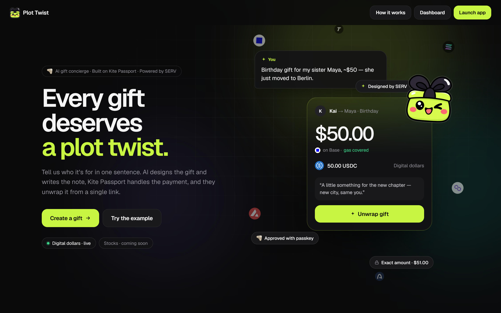
</p>

## The sender's side

| ① One sentence → SERV designs the gift | ② Pick the network (with your Kite balance on each) |
|:---:|:---:|
| 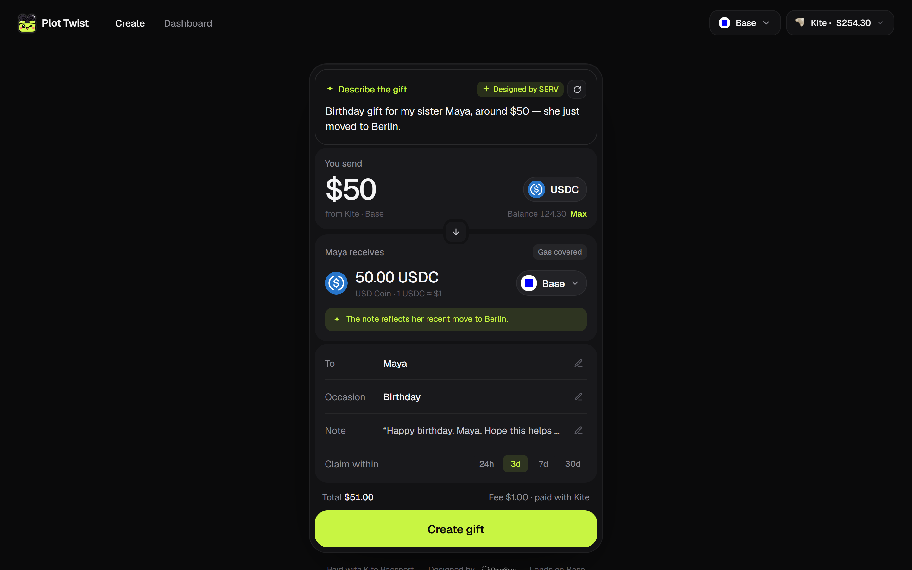 | 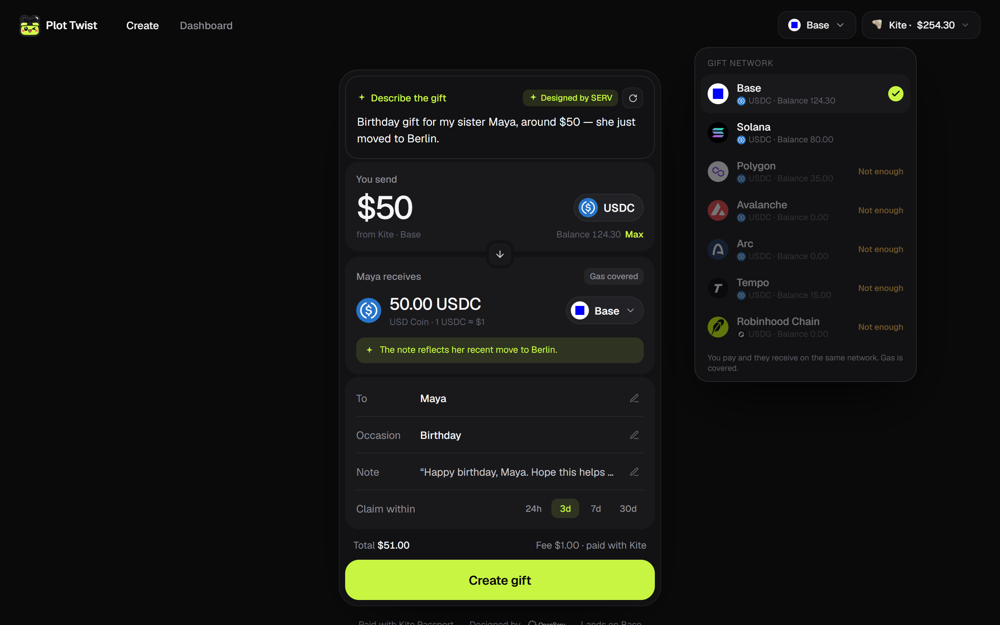 |
| **③ Review: what you pay, what they get** | **④ Approve one exact transfer on Kite Passport** |
| 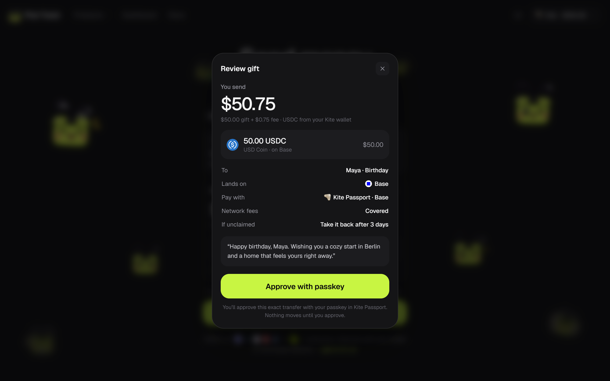 | 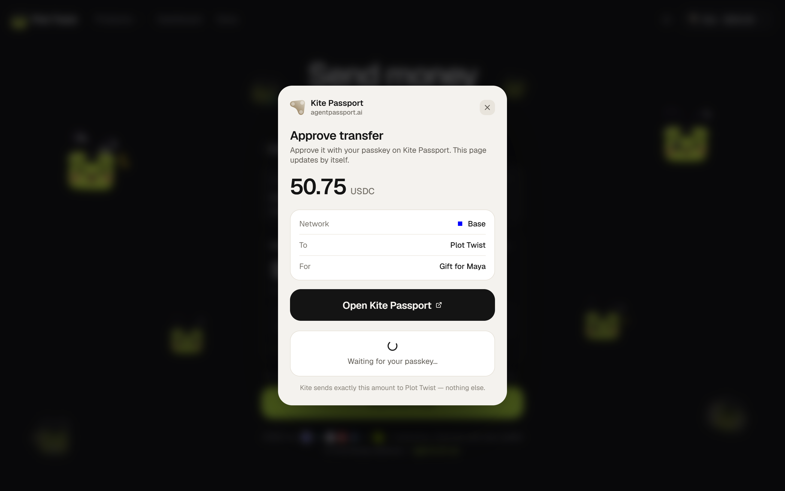 |

<p align="center">
  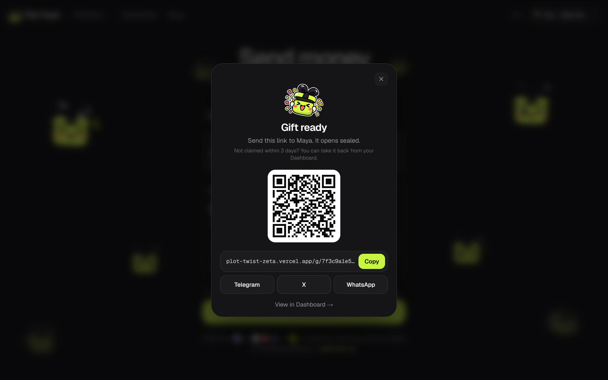
  <br /><sub>⑤ Verified on-chain, sealed, and ready to share — link, QR code, Telegram / X / WhatsApp. Link previews never show the amount.</sub>
</p>

## The recipient's side

| Sealed — who it's from, not what's inside | Revealed — and SERV explains what USDC is |
|:---:|:---:|
| 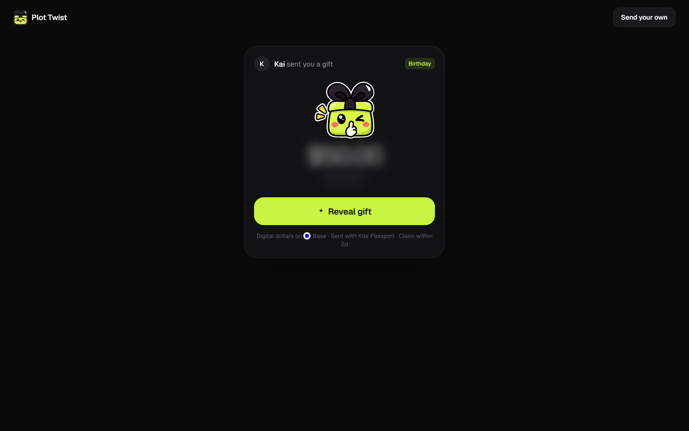 | 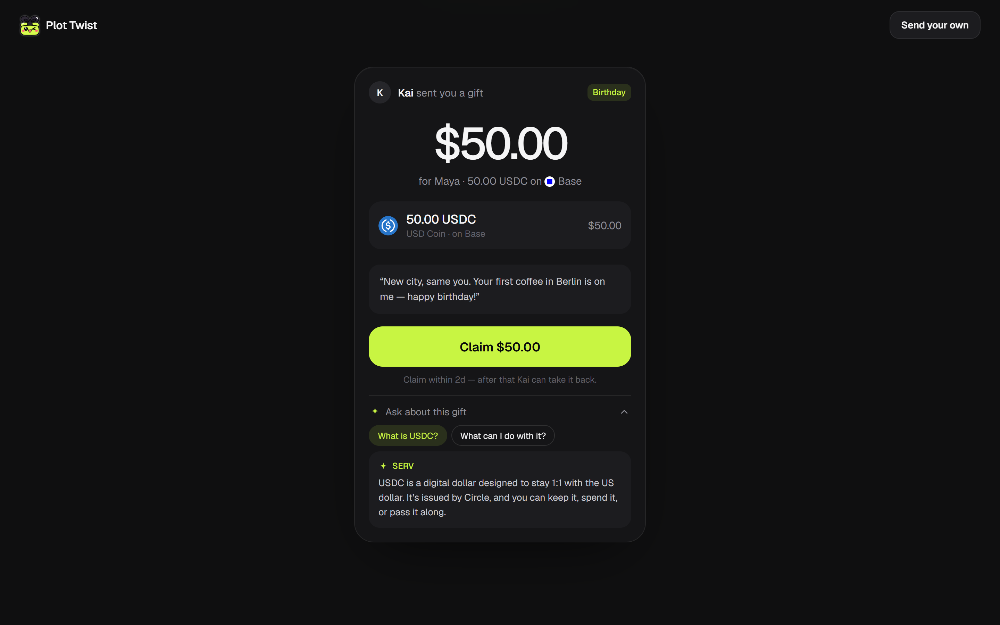 |

<p align="center">
  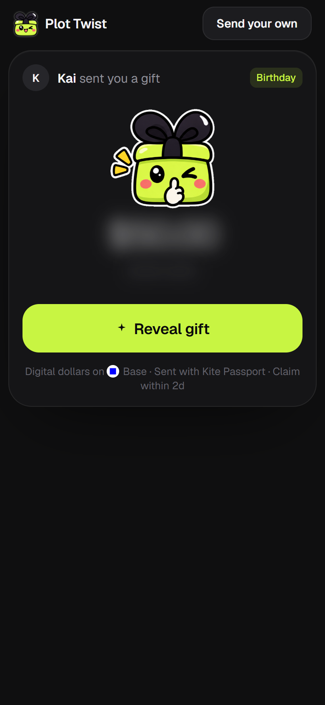
  &nbsp;
  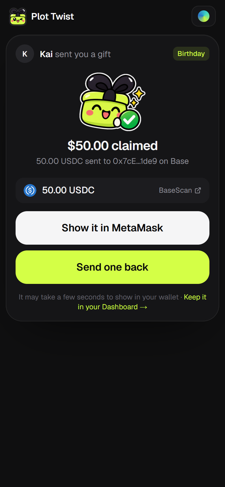
  &nbsp;
  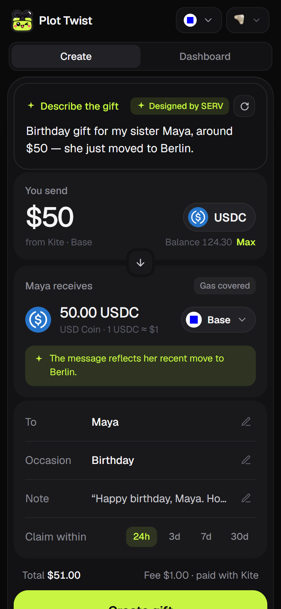
  <br /><sub>Every screen works on phones too.</sub>
</p>

## Dashboard

<p align="center">
  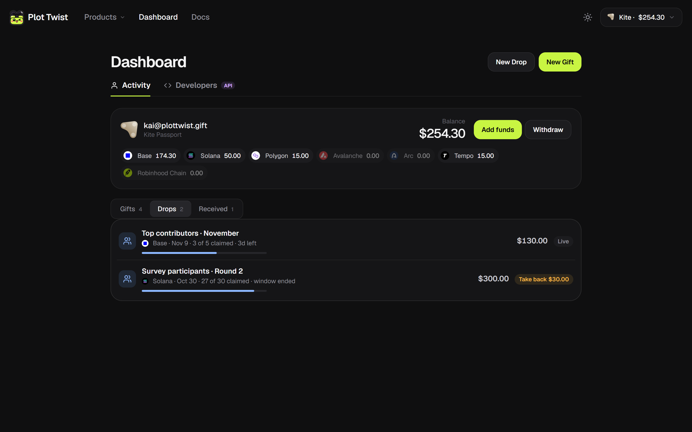
</p>

Your Kite Passport at a glance — balance on each network, **Add funds** and **Withdraw** — plus every gift you've sent (waiting, claimed, or ready to take back) and every gift you've received, whether you claimed it while signed in or on a wallet you linked.

## Meet the gift box

<p align="center">
  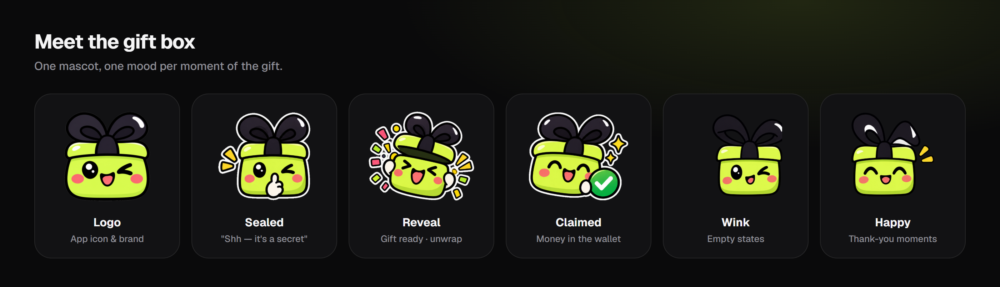
</p>

One mascot carries the whole story: it keeps the secret while the gift is sealed, bursts open on the reveal and celebrates the claim. Every visual comes from a single design system — dark, quiet, one lime accent — shared by the app and the clickable prototype in [`design/`](design).

## How it works

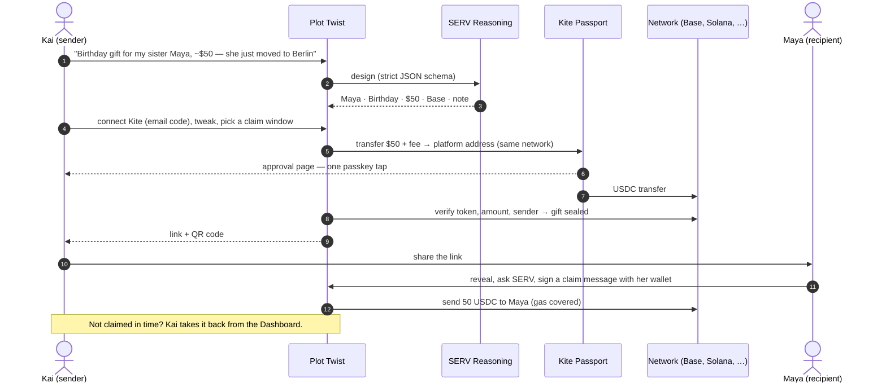

<p align="center">
  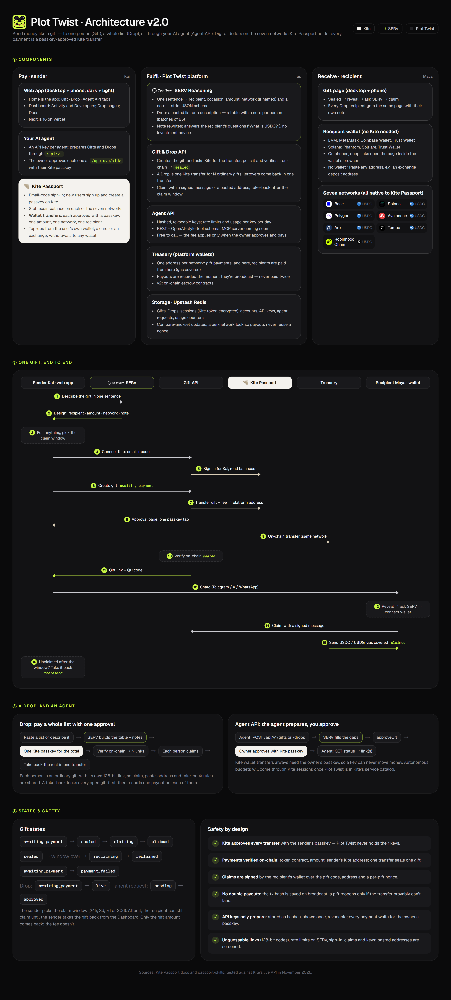
  <br /><sub>Full architecture — components, the end-to-end sequence, gift states and safety. Source: <a href="design/architecture-en.html"><code>design/architecture-en.html</code></a></sub>
</p>

### Where Kite Passport comes in

Plot Twist acts as the sender's agent on Kite Passport, through Kite's HTTP API (`src/lib/kite.ts`):

| | |
|---|---|
| **Sign in / sign up** | Email code; new emails go through Kite sign-up, where the passkey is created |
| **Balances** | Stablecoin balance on each of the seven networks, shown while you design the gift |
| **Pay** | One wallet transfer per gift — gift + fee to the platform address — approved with a passkey on Kite's own page. Plot Twist never holds the sender's keys |
| **Top up** | From the sender's own wallet straight into their Kite address, by card on Kite, or from an exchange |
| **Withdraw** | Back out of Kite to any wallet, again passkey-approved |

### Where SERV comes in

SERV Reasoning (OpenAI-compatible API, `serv-mini`) is the gift's designer and its voice (`src/lib/serv.ts`):

- **Design** — one sentence in any language → recipient, occasion, amount, network (only if you named one) and a note in your language, returned through a strict JSON schema. Everything stays editable.
- **Rewrite** — a fresh take on the note with one tap.
- **Ask about this gift** — answers the recipient's questions ("What is USDC?", "What can I do with it?") in the gift's context, with no investment advice.

### Safety by design

- **Passkey on every transfer**, approved on Kite — one amount, one network, one recipient.
- **Payments verified on-chain**: token contract, amount and the sender's own Kite address; one transfer can seal only one gift.
- **Claims are signed** by the recipient's wallet (EIP-191 / ERC-1271 on EVM, ed25519 on Solana) over the gift code, the address and a per-gift nonce.
- **No double payouts**: a payout's hash is saved the moment it's broadcast, and a gift only reopens when the transfer provably can't land. Payouts on a network go out one at a time.
- **Unguessable links** (128-bit codes), rate limits on SERV, Kite sign-in and claims, the Kite session encrypted server-side, and link previews without amounts.

## Run it locally

Requires Node.js 20+.

```bash
git clone https://github.com/yu7dan/plot-twist.git
cd plot-twist
npm install
cp .env.example .env.local     # add your SERV_API_KEY (console.openserv.ai)
npm run wallet:new             # SESSION_SECRET + platform EVM / Solana hot wallets → .env.local
npm run dev                    # http://localhost:3000
```

To move real money, put a little gas on the platform wallets for the networks you use (e.g. ETH on Base). Gift payments land on those wallets and payouts leave from them.

## Project layout

```
src/app          pages (/, /create, /dashboard, /g/[code]) and API routes
src/lib          Kite client, SERV, gifts, treasury, chains, sessions, signatures, rate limits
src/components   UI on the design system in src/app/styles
design/          clickable prototype, design board, architecture diagram
docs/            roadmap and README images
```

**Stack:** Next.js 16 (App Router) · TypeScript · viem · @solana/web3.js · SERV Reasoning · Kite Passport API.

## What's next

Today, funds waiting to be claimed sit in a platform hot wallet. The next step is **on-chain escrow contracts**, so not even the platform can move them. After that: claiming with just an email, a **gifting autopilot** that sends birthday gifts within limits you approve once on Kite, and group gifts. See the [roadmap](docs/ROADMAP.md).

---

<p align="center">
  <br />
  <sub>Built for SERV Hackathon Edition 02 · Kite track</sub>
</p>
