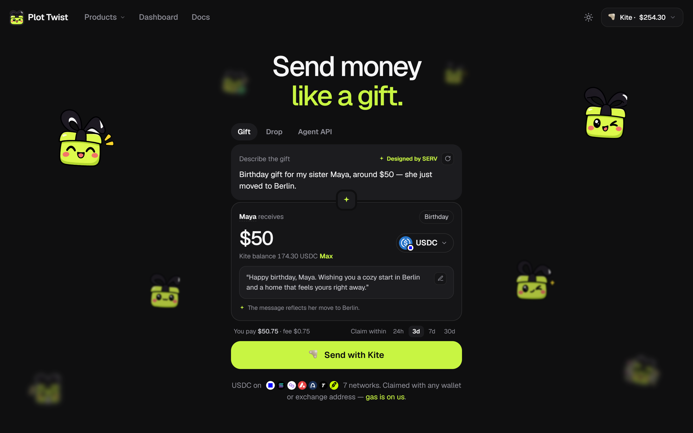
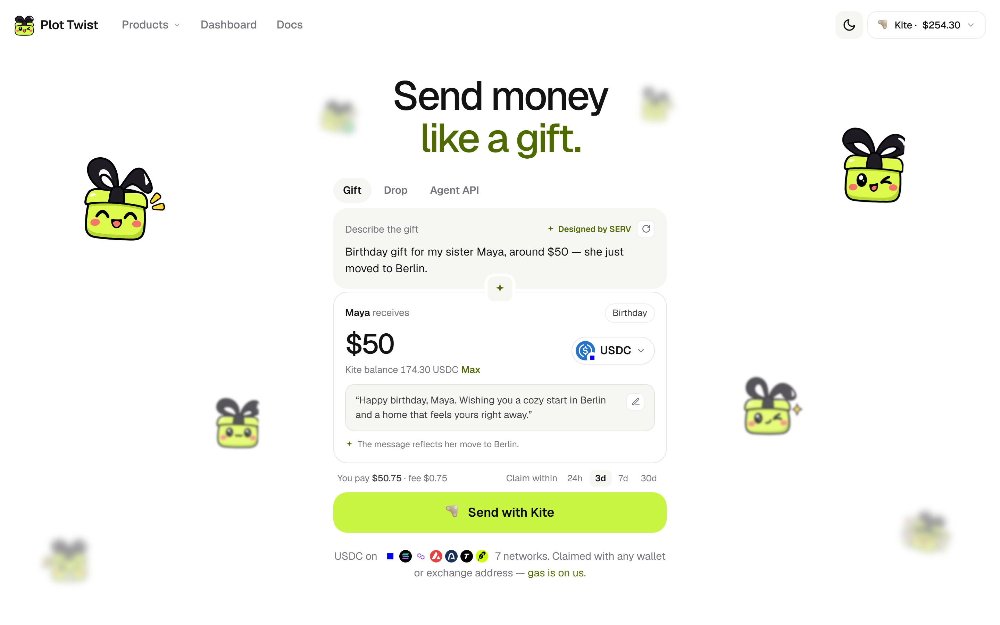
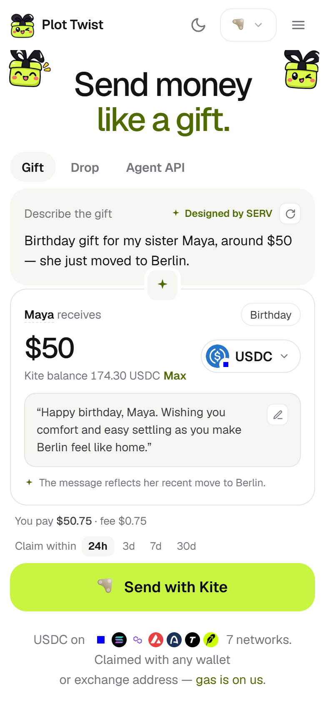
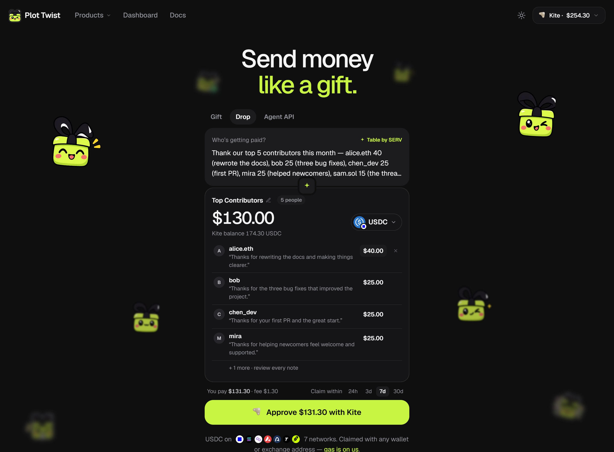
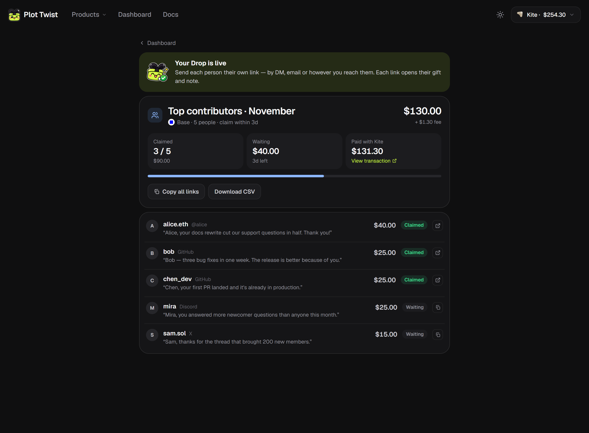
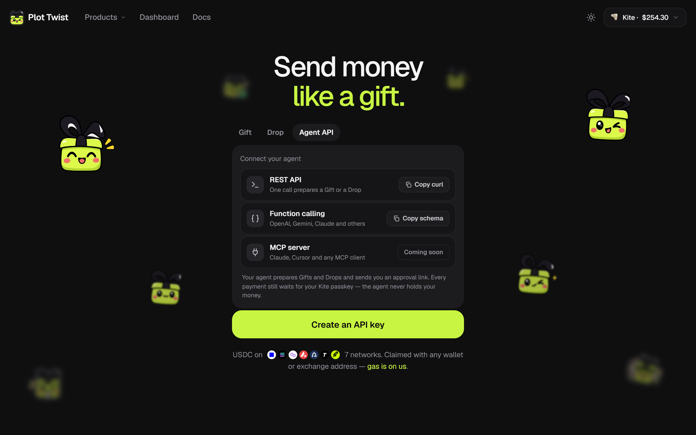
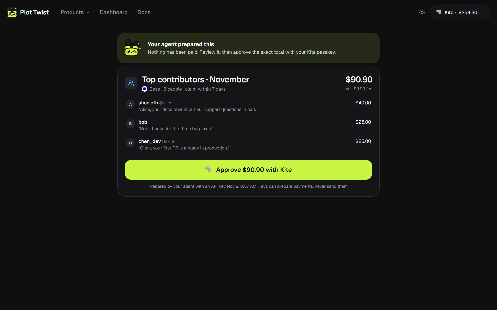
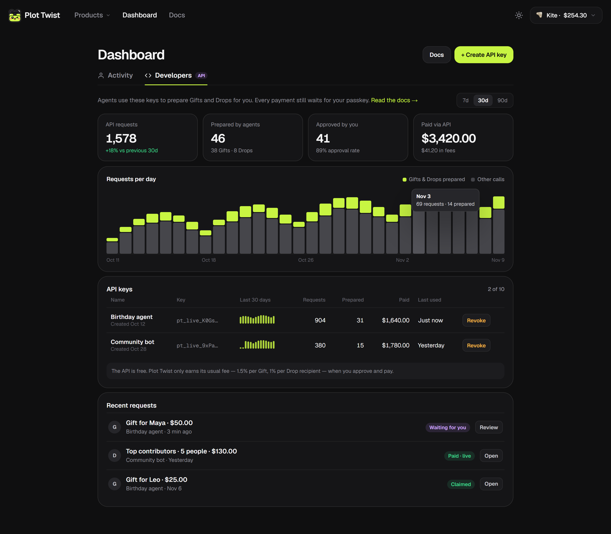
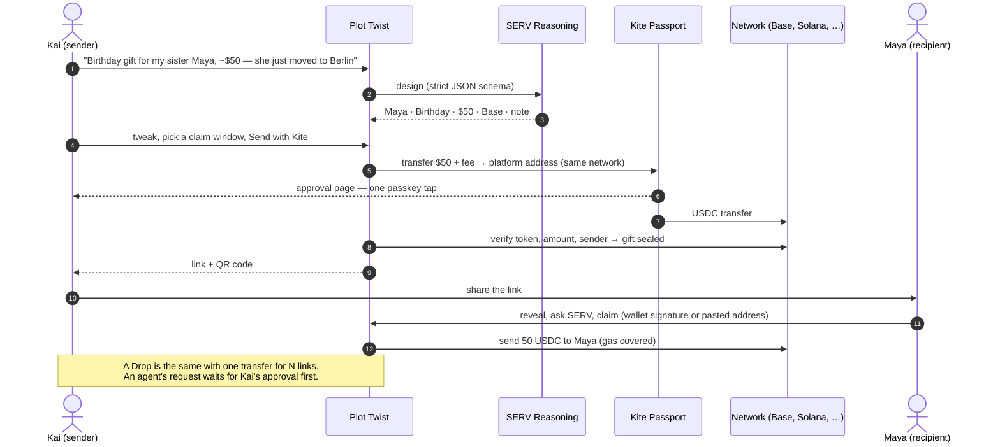

<p align="center">
  
</p>

<p align="center">
  <b>Send money like a gift — to one person, a whole list, or through your AI agent.<br />SERV writes the notes, Kite Passport approves every payment, they claim with any wallet.</b>
</p>

<p align="center">
  <a href="https://plot-twist-zeta.vercel.app"><b>▶ Try it live — plot-twist-zeta.vercel.app</b></a>
</p>

<p align="center">
  
  
  
  
  
</p>

---

## What it is

Sending money to someone usually feels like paying an invoice: an address, a number, no context. Plot Twist turns it into something they open — and it works the same whether you're paying one person, a whole community, or letting your AI agent do it.

| | | |
|---|---|---|
| **Gift** | One person, one gift link | *"Birthday gift for my sister Maya, around $50 — she just moved to Berlin."* SERV designs it and writes the note; it opens sealed. |
| **Drop** | A whole list, one approval | *"$25 to each of our top contributors this month."* SERV builds the table and writes everyone's note; each person gets their own link. |
| **Agent API** | Your AI agent | Your agent prepares Gifts and Drops through the API; you approve each payment with your Kite passkey. |

- **Digital dollars on seven networks** — USDC on Base, Solana, Polygon, Avalanche, Arc and Tempo, and USDG on Robinhood Chain: every network Kite Passport holds stablecoins on.
- **No wallet setup for the sender** — sign in to Kite with an email code (new users get a Passport on the spot), top up from MetaMask / Phantom, a card or an exchange.
- **Recipients need no account** — any EVM or Solana wallet, or just paste an exchange deposit address. Gas is on us.
- **Nothing is lost** — every gift and Drop has a claim window (24h–30d); whatever isn't claimed can be taken back.

<p align="center">
  
  <br /><sub>The home page is the app — one panel with Gift, Drop and Agent API.</sub>
</p>

## Gift — one person

| ① SERV designs it from one sentence (light theme) | ② Review: what you pay, what they get |
|:---:|:---:|
|  |  |
| **③ Approve one exact transfer on Kite Passport** | **④ Verified on-chain, sealed, ready to share** |
|  |  |

The recipient opens a sealed gift, reveals it, can ask SERV what USDC even is, and claims it — with a wallet, or by pasting an exchange address.

| Sealed — who it's from, not what's inside | Revealed — and SERV explains what USDC is |
|:---:|:---:|
|  |  |

<p align="center">
  
  &nbsp;
  
  &nbsp;
  
  <br /><sub>Every screen works on phones too.</sub>
</p>

## Drop — a whole list, one approval

Paying twenty people shouldn't take twenty transfers and twenty wallet addresses. Paste a list (or a CSV, or just describe it), SERV builds the table and writes a personal note for each person, and **one Kite passkey approval pays for every link**.

| SERV builds the table — amounts and notes stay editable | The Drop page: who claimed, copy every link, export CSV |
|:---:|:---:|
|  |  |

Each person gets an ordinary gift link (same claim, paste-address and take-back rules). After the claim window, everything that's unclaimed comes back in **one** transfer. Made for community rewards, bounties and hackathon prizes, research incentives, team bonuses and red packets.

## Agent API — let your agent pay people

AI agents can plan, remember and decide — but paying a person still means asking for their wallet address. With one call your agent prepares a Gift or a Drop; you get an approval link and approve it with your Kite passkey; the agent picks up the claim links and delivers them.

```bash
curl -X POST https://plot-twist-zeta.vercel.app/api/v1/gifts \
  -H "Authorization: Bearer pt_live_…" \
  -H "Content-Type: application/json" \
  -d '{"brief": "Birthday gift for my sister Maya, about $50 — she just moved to Berlin"}'
# → { "id": "…", "status": "pending_approval", "approveUrl": "https://…/approve/…", "gift": { … } }
```

| Connect an agent: REST or function calling (MCP coming soon) | You review what it prepared, then approve on Kite |
|:---:|:---:|
|  |  |

<p align="center">
  
  <br /><sub>Dashboard → Developers: usage per key per day, what agents prepared and you approved, keys shown once and revocable.</sub>
</p>

- **A key can only prepare.** Kite wallet transfers always need the owner's passkey, so an API key can never move money. Keys are stored as hashes, shown once and revocable, with a rate limit each.
- **Endpoints:** `POST /api/v1/gifts`, `POST /api/v1/drops`, `GET /api/v1/{gifts|drops}/{id}`, and OpenAI-style tool definitions at `GET /api/v1/schema`. Full reference in the app at [`/docs`](https://plot-twist-zeta.vercel.app/docs).
- **Free to call.** Plot Twist earns its usual fee only when you approve and pay.

## Dashboard

<p align="center">
  
</p>

**Activity** — your Kite Passport (balance per network, **Add funds**, **Withdraw**), every gift and Drop you sent with its claim status and take-back, and everything you received. **Developers** — the Agent API, shown above.

## How it works



<p align="center">
  
  <br /><sub>Full architecture: components, the end-to-end gift, Drop and agent flows, states and safety.</sub>
</p>

### Where Kite Passport comes in

Plot Twist acts as the sender's agent on Kite Passport, through Kite's HTTP API (`src/lib/kite.ts`):

| | |
|---|---|
| **Sign in / sign up** | Email code; new emails go through Kite sign-up, where the passkey is created |
| **Balances** | Stablecoin balance on each of the seven networks, shown in the panel |
| **Pay** | One wallet transfer per Gift or Drop — amount + fee to the platform address — approved with a passkey on Kite's own page. Plot Twist never holds the sender's keys |
| **Agents** | An agent's request becomes a payment only when the owner approves it with their own Kite session and passkey |
| **Top up / withdraw** | From the sender's own wallet into their Kite address, by card on Kite or from an exchange; back out to any wallet, passkey-approved |

### Where SERV comes in

SERV Reasoning (OpenAI-compatible API, `serv-mini`, `src/lib/serv.ts`) is the designer and the voice:

- **Design a gift** — one sentence in any language → recipient, occasion, amount, network (only if you named one) and a note in your language, through a strict JSON schema.
- **Build a Drop** — a pasted list is parsed locally; a description is turned into a list; SERV writes a note for each person (in batches of 25) and names the Drop.
- **Fill in for agents** — the Agent API lets an agent send just a brief; SERV designs the rest.
- **Rewrite and answer** — a fresh take on a note with one tap, and answers to the recipient's questions ("What is USDC?") without investment advice.

### Business model

Gifts bring people in — every gift turns its recipient into someone who has seen the product work. Drops and the Agent API are where the volume is: communities, teams, researchers and agents paying people again and again.

| | Fee | Minimum |
|---|---|---|
| Gift | 1.5% | $0.25 ($0.50 on Solana, where we pay the recipient's token-account rent) |
| Drop | 1% per recipient | $0.10 ($0.40 on Solana) |
| Agent API | Free to call — the Gift / Drop fee applies when the owner pays | |

Claiming is always free and every payout's gas is covered.

### Safety by design

- **Passkey on every payment**, approved on Kite — one amount, one network, one destination.
- **Payments verified on-chain**: token contract, amount and the sender's own Kite address; one transfer can pay for only one gift or Drop.
- **Claims to a connected wallet are signed** (EIP-191 / ERC-1271 on EVM, ed25519 on Solana) over the gift code, the address and a per-gift nonce. **Pasted addresses** are checksum-validated and screened, so a gift can't go to the platform address, the token contract or a Solana token account.
- **No double payouts**: a payout's hash is saved the moment it's broadcast and a gift only reopens when the transfer provably can't land. Payouts on a network go out one at a time behind a Redis lock, so instances never reuse a nonce; a Drop's take-back locks every open gift first.
- **Unguessable links** (128-bit codes), rate limits on SERV, Kite sign-in, claims and API keys, the Kite session encrypted server-side, and link previews without amounts.

## Run it locally

Requires Node.js 20+.

```bash
git clone https://github.com/yu7dan/plot-twist.git
cd plot-twist
npm install
cp .env.example .env.local     # add your SERV_API_KEY (console.openserv.ai)
npm run wallet:new             # SESSION_SECRET + platform EVM / Solana hot wallets → .env.local
npm run dev                    # http://localhost:3000
```

Without Redis settings, local dev stores everything in JSON files under `data/`. In production (Vercel), set `UPSTASH_REDIS_REST_URL` / `UPSTASH_REDIS_REST_TOKEN` (or connect Upstash through Vercel's integration). To move real money, put a little gas on the platform wallets for the networks you use (e.g. ETH on Base) — payments land on those wallets and payouts leave from them.

## Project layout

```
src/app          pages (/, /dashboard, /drops/[id], /approve/[id], /docs, /g/[code]) and API routes (incl. /api/v1)
src/lib          Kite client, SERV, gifts, Drops, agent requests, API keys, usage, treasury, store (Redis / files)
src/components   home panel (Gift · Drop · Agent API), Dashboard, Drop page, claim page, on the theme in src/app/styles
docs/            roadmap and README images
```

**Stack:** Next.js 16 (App Router) on Vercel · Upstash Redis · TypeScript · viem · @solana/web3.js · SERV Reasoning · Kite Passport API.

## What's next

- **MCP server** for Claude, Cursor and other MCP clients (the API panel already reserves its place).
- **Autonomous agent budgets** — once Plot Twist is listed in Kite's service catalog, agents can pay within a weekly budget the owner approves once on Kite, instead of a tap per payment.
- **On-chain escrow** — funds waiting to be claimed move from the platform hot wallet into escrow contracts, so not even the platform can move them.
- **Claiming with just an email**, a **gifting autopilot**, and **group gifts**. See the [roadmap](docs/ROADMAP.md).

---

<p align="center">
  <br />
  <sub>Built for SERV Hackathon Edition 02 · Kite track</sub>
</p>
